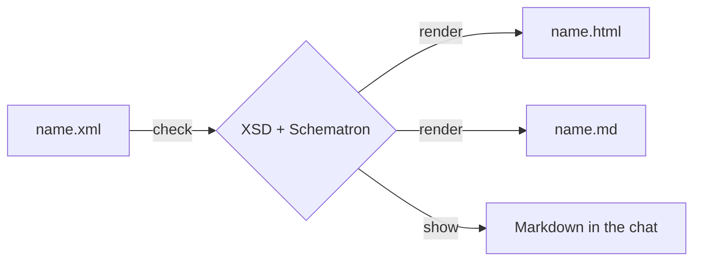

# xmldocs

**An experimental Claude Code skill: one XML source, two views.**

It starts from the thesis of
[*The Unreasonable Effectiveness of HTML*](https://claude.dev/blog/using-claude-code-the-unreasonable-effectiveness-of-html/)
(Thariq Shihipar, Anthropic): for documents an agent writes for people — plans,
specs, reports — HTML works better than Markdown.

xmldocs tries a middle way:

- **the information stays in XML**: typed, validated, with metadata as
  attributes, so it is more structured and easier to search than in Markdown
  or HTML;
- **the visual enrichment is delegated to XSLT**, which generates from each
  XML an HTML view for people and a compact Markdown view for LLMs, the chat
  and GitHub.



Status: 0.1.0, experimental. No automated tests yet.

See the result first: the <a href="views/booklet/xmldocs.html">design rationale as an HTML view</a>
and the <a href="views/booklet/sample-booklet.html">sample booklet</a>, both generated
from the XML files of this repository.

```{toctree}
:maxdepth: 2
:caption: Using xmldocs

getting-started
document-types
vocabulary
chat
```

```{toctree}
:maxdepth: 2
:caption: Background

rationale
sample
```
