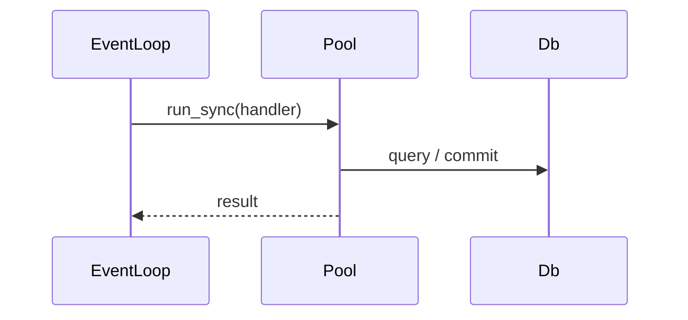

<!-- generated from sample-booklet.xml by xmldocs: do not edit, edit the XML -->

## Sample booklet
*Instruction booklet · booklet/sample-booklet · 2026-10-10*

### Purpose

Shows every element of the base vocabulary: `fact`, `rule`, `diagram`, `embed`.

### Requirements

- Python 3.11
- `lxml` 5 or later

#### 1. Write the document

Code goes in CDATA.

**Example — A condition with < and &**

`demo.py`
```python
if a < b and c & d:
    print("<ok>")
```

#### 2. Draw a diagram


*Sync request*

*[figure: One connection per thread]* — Each pool thread has its own database connection; the event loop has none.

*[figure: Connections by number of threads]* — Connections grow linearly: each thread adds one.

*Table*

| Element | Use |
|---|---|
| `fact` | a verified statement with its source |

### Rules

- **must** — Use CDATA for `code`, `diagram` and `embed`. *(Otherwise a closing tag in the body breaks the parse.)*
- **must-not** — Write a fact without a source.

### Current limits

- Mermaid is the only diagram kind. · `schema/base.xsd`

### Verified facts

- `RUN` `scripts/xmldocs.py` · 2026-10-10 — The script validates and renders this file.

### Decisions

- **d-md** `open` — Should the Markdown view keep the embeds' source?
   1. **Yes**: Longer file, readable on GitHub.
   2. **No**
- **d-cdata** `decided` — How is code written?
   1. **CDATA**
   2. **Manual escaping**
   → Choice: **CDATA** (GP, 2026-10-10) — Readable for an LLM.

### Related documents

- `booklet/xmldocs` (booklet) — Why xmldocs, and how to use it
