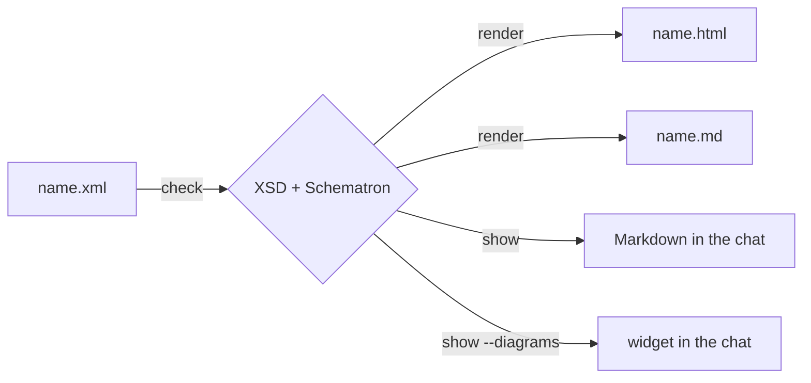

<!-- generated from xmldocs.xml by xmldocs: do not edit, edit the XML -->

## xmldocs: one XML source, two views
*Instruction booklet · booklet/xmldocs · 2026-10-10*

### Purpose

`xmldocs` is an experimental Claude Code skill. It starts from the thesis of [The Unreasonable Effectiveness of HTML](https://claude.dev/blog/using-claude-code-the-unreasonable-effectiveness-of-html/) (Thariq Shihipar, Anthropic): for documents an agent writes for people, HTML works better than Markdown.

It tries a middle way. The information stays in typed XML, where it is more structured and easier to search than in Markdown or HTML. The visual enrichment is delegated to XSLT, which generates from each XML an HTML view for people and a compact Markdown view for LLMs, the chat and GitHub.

*Which format for which purpose*

| Format | Used by | Purpose |
|---|---|---|
| XML | the LLM that writes or edits | Single source. Metadata as attributes, validated by XSD and Schematron. |
| Markdown | the LLM that reads; people in the chat or on GitHub | Compact view with all the metadata. The cheapest format to read. |
| HTML | people | Full reading: facts, rules and decisions set apart visually, diagrams drawn. |

### Requirements

- `uv`, which installs `lxml` for the script in an isolated environment.
- A browser with network access for the Mermaid diagrams of the HTML view, loaded from jsdelivr.

#### 1. Understand why the source is XML

Many sentences of a project document carry metadata: where a fact comes from, how it was verified, whether a decision is open.

In XML the metadata are attributes. In Markdown they become sentences: an LLM has to interpret them and no program can check them.

**Example — The same fact in both formats**

```xml
<fact source="kajenn/src/kajenn/server.py:416" method="read" verified="2026-10-10">
The cleanup of <c>request.db</c> runs on the event loop.</fact>
```

```markdown
Read in the code on 2026-10-10 (`kajenn/src/kajenn/server.py:416`):
the cleanup of `request.db` runs on the event loop.
```

Attributes allow three things Markdown does not:

- Validation. The XSD refuses a fact without a source. Schematron refuses a plan phase started while a decision it needs is still open.
- Filtered views. The script can show one part only, for example the decisions.
- Document types. Each type has required parts: a booklet without steps is invalid.

#### 2. Understand why XML is not enough

XML costs more tokens than Markdown, and people do not read it willingly.

To read, an LLM spends less with the Markdown view than with the XML. The Markdown view keeps every metadata as a short label.

People read the HTML view better: `RUN`, `TEST` and `READ` labels, colours for rule levels and decision states, drawn diagrams.

The price is richness. The HTML of the article is made to measure for each document. The HTML of xmldocs comes from a fixed template per type and is static. For the cases the vocabulary cannot express there is `embed`.

#### 3. Put the files in the right place

The three files sit in the same folder. Only the XML is edited.

```text
xmldocs/<type>/<name>.xml    source
xmldocs/<type>/<name>.md     generated
xmldocs/<type>/<name>.html   generated
```

Public types (`booklet`, `proposal`) live in `xmldocs/` and are committed. Private types (`plan`, `handoff`, `note`) live in `temp/xmldocs/`, which git ignores.

#### 4. Write, validate, generate

```console
uv run --script skills/xmldocs/scripts/xmldocs.py check xmldocs temp/xmldocs
uv run --script skills/xmldocs/scripts/xmldocs.py render xmldocs temp/xmldocs
```

`check` applies the type's XSD, the embed check and the Schematron rules. `render` writes `.md` and `.html` beside every XML.

#### 5. Add hand-made SVG or HTML for edge cases

An `embed` holds SVG or HTML in CDATA and is inserted as is into the HTML view. It is visual only: the required `summary` carries the information in text, and the Markdown view shows title and summary.

**Example — An SVG embed**

```xml
<embed kind="svg" id="e-threads" title="One connection per thread"
       summary="Each pool thread has its own connection; the event loop has none.">
<![CDATA[ <svg viewBox="0 0 420 130"> … </svg> ]]>
</embed>
```

Colours come from the page variables (`var(--fg)`, `var(--panel)`, …), so the embed follows light and dark mode.

Script tags, `on…=` handlers and `javascript:` URLs are refused unless the embed says `scripts="true"`. With it, `check` prints a warning and the HTML marks the embed `SCRIPT`.

#### 6. Show a document in the chat

```console
uv run --script skills/xmldocs/scripts/xmldocs.py show temp/xmldocs/handoff/2026-10-10.xml --part next
uv run --script skills/xmldocs/scripts/xmldocs.py show xmldocs/booklet/kajenn-app.xml --diagrams
```

`show` prints the Markdown view and writes no file. In the chat a diagram or an embed becomes one placeholder line, because the chat does not draw Mermaid.

`--diagrams` prints the Mermaid sources and the embeds. They are shown with an inline HTML widget, starting from `references/mermaid-widget.html`.


*One source, four uses*

### Rules

- **must** — Edit only the XML, and regenerate `.md` and `.html` after every change.
- **must** — Verify every `fact` with tools before writing it. *(A statement not verified against a source is not a fact.)*
- **must** — Write `code`, `diagram` and `embed` bodies in CDATA.
- **must** — Run the script with `uv run --script` and an absolute path. *(uv falls back to the enclosing project when the script path does not exist, and creates its uv.lock and .venv.)*
- **must-not** — Name a private document in a public one.
- **must-not** — Use `loop`, `alt`, `opt`, `par`, `end` or `note` as participant names in a sequence diagram. *(They are Mermaid keywords: the diagram is not drawn.)*

### Current limits

- The script does not detect Mermaid syntax errors: Mermaid runs in the browser. A diagram is checked by opening the HTML. · `scripts/xmldocs.py`
- The side panel of the desktop app may show a local HTML file as a static snapshot. Mermaid does not run there and the diagram stays as source.
- XSD 1.0 has no assertions. Rules between attributes are in Schematron (`schema/rules.sch`). · `schema/base.xsd`
- In the chat, links between documents cannot be followed. The Markdown view shows an internal reference as text followed by `(→ id)`.
- The fixed labels of the views are in English only. A per-language file that redefines them is planned, not written. · `xslt/labels.xsl`
- The content of an `embed` is not validated: broken HTML breaks the page.

### Verified facts

- `RUN` `tiktoken o200k_base, handoff of 2026-10-10` · 2026-10-10 — Same handoff: hand-written Markdown 1,139 tokens, XML 1,742, HTML 4,070 (1,530 of them CSS), generated Markdown view 1,234. Claude's tokenizer was not available: the ratios are indicative.
- `READ` `handoff of 2026-10-10` · 2026-10-10 — The generated Markdown view carries source, method and date of 12 facts; the hand-written handoff carries the source of some and the method of none.
- `RUN` `Claude Code desktop chat` · 2026-10-10 — A `` ```mermaid `` block in the reply text appears as code. The same source in an inline HTML widget is drawn.
- `RUN` `Claude Code desktop chat` · 2026-10-10 — With the `base` theme in dark mode, participant boxes have unreadable text until `actorBkg` and `actorTextColor` are set.
- `RUN` `browser pane, sample-booklet.html` · 2026-10-10 — An SVG embed using the page variables is readable in light and dark mode; an HTML embed with `scripts="true"` runs its script.

### Related documents

- `booklet/sample-booklet` (booklet) — Every element of the base vocabulary
